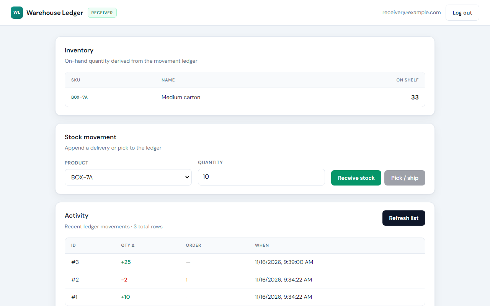
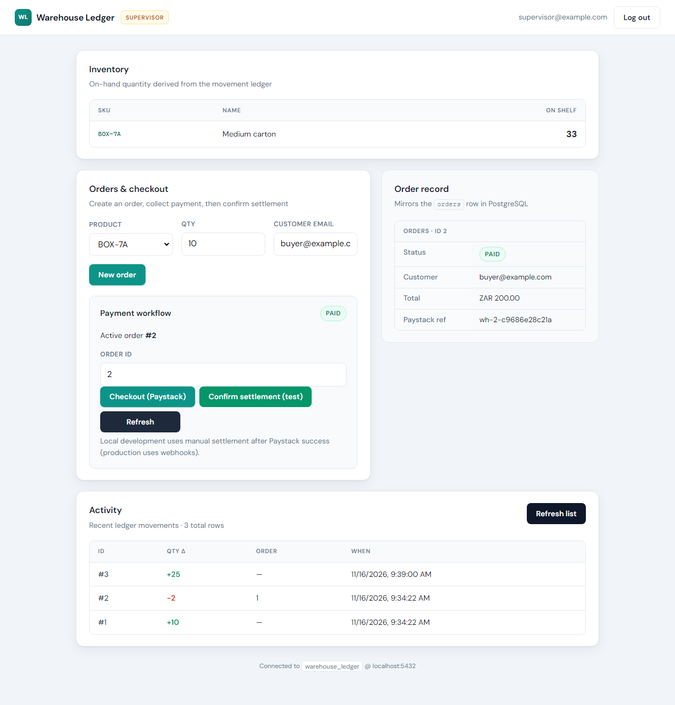
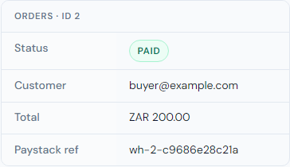

# Warehouse Ledger

[](https://github.com/JoshStevens582/warehouse-ledger/actions/workflows/ci.yml)

Full-stack warehouse demo: **append-only stock movements** in PostgreSQL, **JWT roles**, and **Paystack** checkout with signed webhooks. Built to show backend Python practices recruiters care about (tests, types, migrations, payment idempotency).

**Live demo:** https://ledger.102-203-81-249.sslip.io (demo logins in README Quick start)

## Problem

Warehouses need a trustworthy shelf count. This app **never stores “on shelf” as an editable number**. Every delivery and pick is one row in `stock_movements`; the API reports shelf quantity as **`SUM(quantity_delta)`**. Orders and payments live in their own tables so money and inventory stay auditable.

## Screenshots

| Inventory (receiver) | Orders & checkout (supervisor, paid) | Order record (`orders` row) |
| --- | --- | --- |
|  |  |  |

Regenerate: `node scripts/capture-screenshots.mjs` (API + Vite on port 5173; run `scripts/prepare_readme_screenshots.ps1` first if needed).

## Stack

- **Python:** FastAPI, SQLAlchemy 2, Alembic, Pydantic
- **DB:** PostgreSQL (ledger + orders + payments)
- **Auth:** JWT, roles `receiver` | `picker` | `supervisor`
- **Payments:** Paystack initialize, HMAC webhooks, idempotent `payments` rows
- **Async jobs:** ARQ + Redis. After payment the worker writes one receipt and retries up to 3 times. A second run does not write another receipt.
- **UI:** React (Vite) — thin client over `/api`
- **Quality:** pytest (branch coverage), Ruff, Mypy, GitHub Actions

## Quick start

**Windows (local Postgres on 5432):**

1. Run `scripts/init_local_postgres.sql` once in pgAdmin.
2. `copy .env.example .env` — set Paystack **test** keys; set `CHECKOUT_CALLBACK_URL` to your Vite URL (e.g. `http://localhost:5173/`).
3. From this folder:

```bash
uv sync --group dev
uv run alembic upgrade head
uv run uvicorn warehouse_ledger.main:app --host 127.0.0.1 --port 8080
```

4. UI: `cd frontend && npm install && npm run dev`

| Role | Email | Password |
| --- | --- | --- |
| Receiver | receiver@example.com | receiver123 |
| Picker | picker@example.com | picker123 |
| Supervisor | supervisor@example.com | supervisor123 |

**API docs:** [http://127.0.0.1:8080/docs](http://127.0.0.1:8080/docs)  
**Health:** `GET /api/health` (includes DB name + movement row count)

Docker and Redis notes: see comments in `.env.example` and `docker-compose.yml`.

## Demo for interviews

Step-by-step script: **[docs/DEMO.md](docs/DEMO.md)** (~2 minutes).

**30-second version:**

1. Movements are append-only; shelf total is a SQL sum.
2. Roles enforce who can deliver vs pick vs manage orders.
3. Order → Paystack reference → webhook verifies HMAC → one payment row; duplicate events ignored.
4. On localhost, Paystack cannot POST webhooks: after Success, supervisor uses **Confirm payment** (`POST /api/orders/{id}/sync-payment`, verifies with Paystack). Supervisor-only **Checkout** opens Paystack.

## Tests

```bash
uv run ruff check .
uv run mypy src
uv run pytest --cov=warehouse_ledger --cov-branch
```

Browser (Playwright): picker must not reach Paystack checkout — API returns 403 and the UI hides supervisor checkout.

```bash
uv run alembic upgrade head
cd e2e && npm ci && npx playwright install chromium && npm test
```

CI runs pytest and the Playwright job on push (Postgres + Redis service containers). Prefer a dedicated `warehouse_ledger_test` database so pytest does not wipe your play data — see `.env.example`.

## CV copy-paste

Ready-made bullets: **[docs/CV-BULLETS.md](docs/CV-BULLETS.md)**

Public hosting (optional): **[docs/DEPLOY.md](docs/DEPLOY.md)**

## Project layout

| Path | Purpose |
| --- | --- |
| `src/warehouse_ledger/` | API, models, Paystack, services |
| `alembic/` | Migrations |
| `tests/` | pytest (roles, webhooks, record-test-payment) |
| `e2e/` | Playwright (picker blocked from checkout) |
| `frontend/` | Vite React UI |
| `scripts/` | Postgres init, Paystack webhook relay (local dev) |